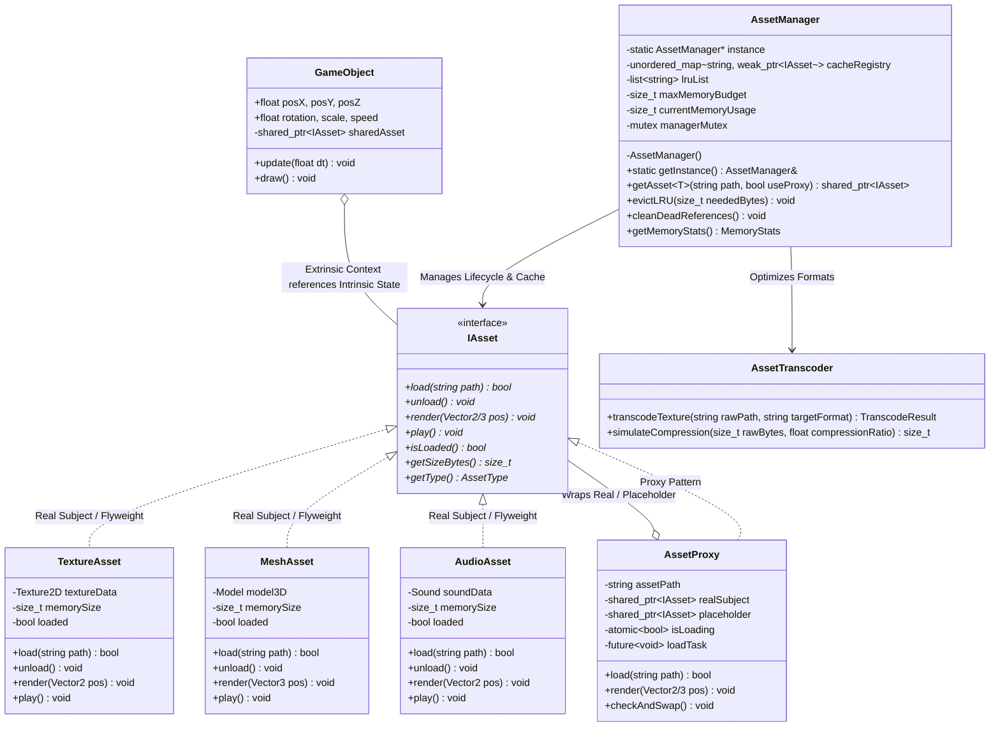

# Kế Hoạch Triển Khai: Game Asset Management Framework (Thuần C++ / Raylib Native Game Window)

## 1. Mục Tiêu Dự Án (Project Goal)
Xây dựng một thư viện phần mềm quản lý tài nguyên trò chơi (Game Asset Management Framework) đa nền tảng, hoàn toàn bằng **C++ thuần (Modern C++17/20)**, áp dụng chuẩn mực các mẫu thiết kế hướng đối tượng (**OOP & Design Patterns**):
- **Singleton Pattern**: `AssetManager` là điểm truy cập duy nhất điều phối tài nguyên, quản lý Cache Registry và đếm tham chiếu (Reference Counting).
- **Flyweight Pattern**: Tách biệt trạng thái nội tại (*Intrinsic State* - dữ liệu nặng như pixel buffer, 3D vertices, audio samples) và trạng thái ngoại tại (*Extrinsic State* - tọa độ X, Y, Z, góc xoay, scale trong `GameObject`), cho phép hiển thị hàng ngàn thực thể cùng lúc mà không làm phình RAM/VRAM.
- **Proxy Pattern (Virtual Proxy & Lazy Loading)**: Đại diện cho tài sản chưa nạp, trả về placeholder nhẹ (ảnh mờ/low-res hoặc wireframe) và nạp dữ liệu thật trên luồng ngầm (*Background Worker Thread*) không gây đứng hình màn hình chính (anti-stuttering).
- **Cache Engine & LRU Eviction**: Quản lý bộ nhớ đệm tự động dọn dẹp khi bộ nhớ vượt ngưỡng hoặc khi không còn tham chiếu (`weak_ptr`).
- **Asset Transcoder/Converter**: Mô phỏng/thực hiện nén chuyển mã tài sản (Raw RGBA $\to$ Compressed Texture) tối ưu VRAM.
- **Native Game Window & Memory Profiler Dashboard**: Sử dụng **Raylib** (thư viện đồ họa C++ nhẹ, hiệu năng cao) để mở một cửa sổ Game Native C++, mô phỏng chiến trường với quái vật/vật thể, tích hợp Dashboard đo RAM/VRAM, FPS, Cache Count thời gian thực, có phím bấm Bật/Tắt Flyweight & Proxy để đối chứng hiệu năng.
- **Quy chuẩn Code C++**: Thống nhất sử dụng `using namespace std;` trong các file implementation để cú pháp gọn gàng, sáng sủa, dễ đọc cho sinh viên và giảng viên.

---

## 2. Kiến Trúc & Thiết Kế Lớp (OOP Architecture)

### 2.1. Sơ Đồ Quan Hệ Lớp (UML Class Diagram)


---

## 3. Lộ Trình Triển Khai Chi Tiết (5 Bước Theo Đúng Đề Bài)

### Bước 1: Khởi Tạo Dự Án CMake & Khung Core Interfaces (Singleton + IAsset)
- Cấu hình `CMakeLists.txt` sử dụng MinGW-w64 g++, tự động tích hợp **Raylib** qua `FetchContent` (hoặc tải thư viện prebuilt/single static lib, không đòi hỏi cài đặt môi trường rườm rà).
- Triển khai `IAsset.hpp`: Interface định nghĩa các pure virtual functions: `load()`, `unload()`, `render()`, `play()`, `getSizeBytes()`, `isLoaded()`.
- Triển khai `AssetManager` (Singleton Pattern):
  - Khởi tạo Thread-safe (Meyers' Singleton).
  - Khai báo Cache Registry sử dụng `unordered_map<string, weak_ptr<IAsset>>` để hỗ trợ giải phóng bộ nhớ tự động khi ref count bằng 0.

### Bước 2: Triển Khai Core Assets & Mẫu Flyweight (Texture, Mesh, Audio)
- Cài đặt các lớp tài sản cụ thể:
  - `TextureAsset`: Tải ảnh 2D, lưu VRAM qua Raylib Texture2D, hỗ trợ render sprite.
  - `MeshAsset`: Tải mô hình 3D (dạng cube, sphere hoặc obj 3D), hỗ trợ render 3D camera.
  - `AudioAsset`: Tải và phát âm thanh (WAV/MP3/OGG) qua Raylib Audio Engine.
- Triển khai **Flyweight Pattern**:
  - `GameObject`: Chỉ lưu *Extrinsic State* (vị trí X, Y, Z, góc quay, tốc độ, animation frame index).
  - Tích hợp `shared_ptr<IAsset>`: Hàng trăm `GameObject` cùng loại quái vật/cây cối dùng chung 1 con trỏ `shared_ptr` duy nhất.
  - Cơ chế đếm tham chiếu (Reference Counting): Khi các `GameObject` bị tiêu diệt $\to$ số tham chiếu về 0 $\to$ bộ nhớ tự động được dọn khỏi RAM/VRAM.

### Bước 3: Phát Triển Mẫu Proxy & Pipeline Nạp Bất Đồng Bộ (Async Loader)
- Triển khai `AssetProxy`:
  - Đóng vai trò **Virtual Proxy** / **Lazy Loading Proxy**.
  - Ban đầu trỏ đến một `PlaceholderAsset` siêu nhẹ (ảnh low-res mờ pixel hoặc hình vẽ icon loading spinner).
  - Kích hoạt `thread` / `async` nạp ngầm file gốc từ đĩa (hoặc mô phỏng độ trễ đường truyền Cloud/Disk).
  - Khi luồng ngầm hoàn thành, tự động tráo đổi (*atomic swap*) từ Placeholder sang Real Asset mà không làm sụt giảm FPS của luồng vẽ chính.

### Bước 4: Lập Trình Cache Engine (LRU) & Bộ Chuyển Mã (Asset Transcoder)
- **LRU Cache & Memory Budget Threshold**:
  - Khi bộ nhớ vượt ngưỡng cấu hình (ví dụ: giới hạn 256MB), thuật toán LRU (`list` + hash map) sẽ tự động tìm và dọn dẹp các tài sản ít được dùng nhất mà không còn active reference.
- **Bộ chuyển mã (Asset Transcoder/Converter)**:
  - Tạo lớp `AssetTranscoder`: Hỗ trợ mô phỏng và chuyển mã định dạng đồ họa từ uncompressed (Raw RGBA 32-bit) sang định dạng tối ưu nén GPU (DXT/ETC/WebP/DDS), hiển thị sự khác biệt kích thước dữ liệu (tiết kiệm đến 70-80% VRAM).

### Bước 5: Màn Hình Game Demo & Profiler Dashboard
- **Màn hình Game C++ (Raylib Native Window 1280x720)**:
  - Khung cảnh mô phỏng chiến trường (Swarm Defense / Monster Horde) với các thực thể chuyển động mượt mà.
  - Hỗ trợ cả sprite 2D lẫn âm thanh hiệu ứng khi click chuột/tấn công.
- **Memory Profiler Dashboard (Vẽ trực tiếp trên góc màn hình game)**:
  - Biểu đồ thời gian thực: RAM Usage (MB), VRAM Texture Memory, FPS, Delta Time.
  - Số lượng Asset đang nạp trong Cache Registry, số lượng `GameObject` active.
- **Bảng Điều Khiển Tương Tác (Interactive Controls)**:
  - Phím `[1]`: Toggle **Flyweight Pattern** (Bật: 1.000 quái dùng 10MB; Tắt: 1.000 quái tốn 1.000 x 10MB = 10GB $\to$ RAM vọt đỉnh!).
  - Phím `[2]`: Toggle **Proxy Async Loading** (Bật: Game chạy 60 FPS mượt mà nhờ Placeholder; Tắt: Game bị khựng/lag spike 2-3 giây khi nạp tài nguyên nặng).
  - Phím `[3]`: Kích hoạt **LRU Cache Clean / Evict Memory**.
  - Phím `[4]`: Kích hoạt **Transcoder Demo** (Chuyển đổi nén Texture).
  - Phím `[SPACE]`: **Spawn thêm 50 quái vật** mỗi lần nhấn để quan sát sự thay đổi tài nguyên từng nấc rõ ràng.

---

## 4. Cấu Trúc Thư Mục Dự Án (Project Structure) & Chi Tiết Tác Dụng Từng File

```
project/
├── CMakeLists.txt              # Script build dự án bằng CMake, tự động liên kết Raylib và g++
├── Plan.md                     # Kế hoạch triển khai chi tiết dự án
├── docs/
│   └── UML_Class_Diagram.md   # Tài liệu sơ đồ thiết kế lớp UML (Mermaid format)
├── assets/                     # Kho tài nguyên gốc (Texture 2D, Audio WAV, 3D Mesh)
│   ├── textures/
│   ├── audio/
│   └── models/
├── include/                    # Thư mục Header files (.hpp)
│   ├── IAsset.hpp              # Interface gốc định nghĩa hợp đồng chung (load, unload, render, play)
│   ├── TextureAsset.hpp        # Khai báo lớp tài sản ảnh 2D (Flyweight Intrinsic State)
│   ├── MeshAsset.hpp           # Khai báo lớp tài sản mô hình 3D
│   ├── AudioAsset.hpp          # Khai báo lớp tài sản âm thanh
│   ├── AssetProxy.hpp          # Khai báo Virtual Proxy nạp bất đồng bộ (Async Worker Thread)
│   ├── AssetManager.hpp        # Khai báo Singleton quản lý Cache Registry & thuật toán LRU
│   ├── AssetTranscoder.hpp     # Khai báo bộ chuyển mã/nén định dạng tối ưu VRAM
│   ├── GameObject.hpp          # Khai báo đối tượng game chứa Extrinsic State (vị trí, góc quay)
│   ├── MemoryProfiler.hpp      # Khai báo bộ đo RAM thực từ OS Windows API và VRAM, FPS
│   └── GameScene.hpp           # Khai báo quản lý khung cảnh game, vòng lặp spawn và cập nhật quái vật
└── src/                        # Thư mục Implementation (.cpp) - Sử dụng 'using namespace std;'
    ├── main.cpp                # Khởi tạo cửa sổ Raylib, vòng lặp game chính (Game Loop) và xử lý phím tắt
    ├── TextureAsset.cpp        # Triển khai nạp ảnh vào VRAM, vẽ sprite bằng Raylib, giải phóng bộ nhớ khi hủy
    ├── MeshAsset.cpp           # Triển khai nạp lưới 3D, vẽ khối 3D với góc xoay/tỉ lệ, giải phóng dữ liệu đỉnh
    ├── AudioAsset.cpp          # Triển khai nạp file âm thanh vào RAM, gọi hàm play/stop qua audio engine Raylib
    ├── AssetProxy.cpp          # Triển khai logic Virtual Proxy: hiển thị Placeholder tạm, kích hoạt std::thread nạp ngầm file thật và tráo đổi (swap)
    ├── AssetManager.cpp        # Triển khai Singleton (getInstance), quản lý unordered_map với weak_ptr, thuật toán xóa LRU khi đầy RAM
    ├── AssetTranscoder.cpp     # Triển khai thuật toán chuyển đổi/giả lập nén texture (Raw RGBA -> DXT/Compressed), tính toán % RAM tiết kiệm
    ├── GameObject.cpp          # Triển khai cập nhật tọa độ di chuyển, gọi render() trên con trỏ IAsset dùng chung
    ├── MemoryProfiler.cpp      # Triển khai gọi API Windows (GetProcessMemoryInfo) đo RAM thực của tiến trình và đếm VRAM
    └── GameScene.cpp           # Triển khai logic thêm 50 quái vật khi bấm SPACE, quản lý danh sách quái vật, hiển thị Dashboard lên màn hình
```

---

## 5. Kế Hoạch Kiểm Thử & Đánh Giá (Verification Plan)
1. **Kiểm thử Singleton & Cache Registry**:
   - Gọi `AssetManager::getInstance()` từ nhiều nơi, đảm bảo trả về duy nhất 1 địa chỉ bộ nhớ.
   - Khi `GameObject` hủy, kiểm tra `weak_ptr::expired() == true` và bộ nhớ RAM giảm ngay lập tức.
2. **Kiểm thử Flyweight**:
   - Nhấn `[SPACE]` spawn theo từng đợt 50 quái vật: Bộ nhớ Texture chỉ tính 1 lần duy nhất (~5-10MB).
   - Tắt Flyweight (phím `[1]`): Bộ nhớ tăng tuyến tính theo từng đợt 50 quái vật, chứng minh hiệu quả giảm tải RAM rõ rệt.
3. **Kiểm thử Proxy & Async Loading**:
   - Nạp tài nguyên giả lập độ trễ 2 giây: Vật thể xuất hiện ngay lập tức với hình ảnh tạm (Placeholder), FPS giữ vững 60 FPS, không có hiện tượng freeze frame. Sau 2 giây tự động chuyển sang đồ họa sắc nét.
4. **Kiểm thử LRU Cache & Transcoder**:
   - Nạp vượt ngưỡng Memory Budget $\to$ các asset cũ nhất bị purge tự động.
   - Nhấn `[4]` kích hoạt Transcoder nén asset, kiểm tra log dung lượng trước và sau chuyển đổi.
