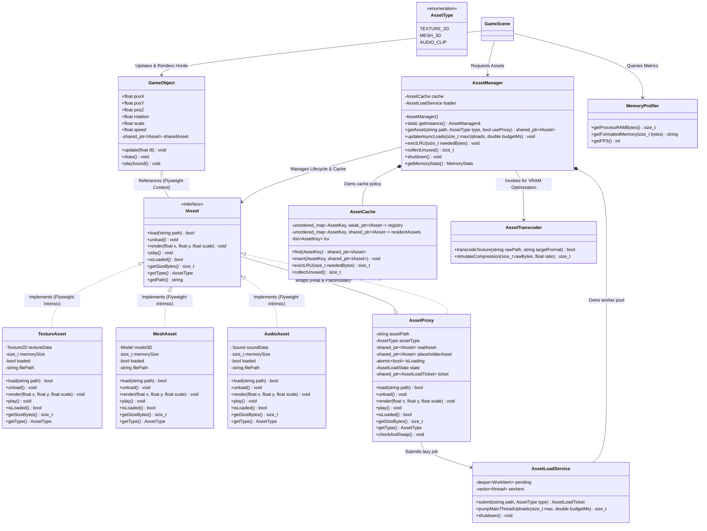

# Thiết Kế Hệ Thống & Sơ Đồ Lớp (UML Class Diagram)

## 1. Tổng quan Kiến trúc (Architecture Overview)
Dự án được xây dựng dựa trên các nguyên lý Hướng đối tượng (OOP) và 3 mẫu thiết kế cốt lõi:
1. **Singleton Pattern**: `AssetManager` là trung tâm điều phối tài nguyên, kiểm soát Cache Registry và vòng đời tài sản.
2. **Flyweight Pattern**: Tách biệt trạng thái nội tại (*Intrinsic State* - `IAsset` chứa mảng pixel texture, đỉnh 3D, âm thanh) và trạng thái ngoại tại (*Extrinsic State* - `GameObject` chứa tọa độ X, Y, Z, góc xoay, vận tốc).
3. **Proxy Pattern (Virtual Proxy)**: `AssetProxy` hoạt động như một đại diện cho tài nguyên thực, cung cấp hình ảnh tạm thời (*Placeholder*) và nạp dữ liệu thật trên luồng ngầm (*Background Thread*) để tránh nghẽn khung hình.

---

## 2. Sơ đồ lớp chi tiết (UML Class Diagram)

---

## 3. Trách nhiệm các mẫu thiết kế

### 3.1. Singleton Pattern (`AssetManager`)
- **Động cơ**: Chỉ một bộ điều phối tài nguyên duy nhất tồn tại trong suốt vòng đời game để tránh lãng phí RAM/VRAM và xung đột cache.
- **Cơ chế đếm tham chiếu (Reference Counting)**:
  - Cache Registry sử dụng `unordered_map<string, weak_ptr<IAsset>>`.
  - Bộ quản lý không sở hữu độc quyền tài nguyên (không giữ `shared_ptr`), mà trao quyền sở hữu cho các `GameObject`. Khi mọi đối tượng bị tiêu diệt, `weak_ptr.expired()` kích hoạt và giải phóng bộ nhớ tự động.

### 3.2. Flyweight Pattern (`IAsset` & `GameObject`)
- **Động cơ**: Vẽ 1.000 quái vật giống nhau. Nếu mỗi quái vật tạo một bản sao texture 10MB $\to$ tiêu tốn $1.000 \times 10\text{MB} = 10\text{GB}$ RAM (gây tràn bộ nhớ).
- **Giải pháp**:
  - **Intrinsic State** (Nội tại, không đổi): Nằm trong `IAsset` (`TextureAsset` / `MeshAsset`), chỉ cấp phát đúng **1 lần** (~10MB).
  - **Extrinsic State** (Ngoại tại, biến đổi): Vị trí X, Y, vận tốc, góc quay trong từng `GameObject` (~40 bytes/object).
  - Kết quả: $1.000$ quái vật chỉ tốn $\approx 10\text{MB} + 40\text{KB}$, tiết kiệm **99.6%** bộ nhớ.

### 3.3. Proxy Pattern (`AssetProxy`)
- **Động cơ**: Nạp file đồ họa 4K hoặc Mesh lớn từ đĩa/mạng mất 1-2 giây. Nếu nạp đồng bộ (Synchronous), game loop sẽ bị đứng hình (stuttering/lag spike).
- **Giải pháp**:
  - `AssetProxy` implement cùng interface `IAsset`.
  - Khi chưa nạp xong, `render()` sẽ vẽ `placeholderAsset` (ảnh mờ nhẹ hoặc icon loading xoay).
  - `AssetLoadService` dùng worker pool đọc/giải mã CPU; main thread upload theo ngân sách mỗi frame.
  - Khi hoàn thành, con trỏ được tráo đổi (`swap`) trong một thao tác an toàn luồng, game tiếp tục chạy 60 FPS mượt mà.
